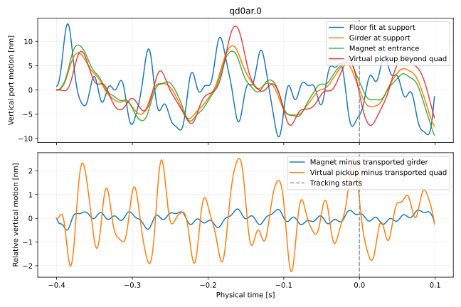
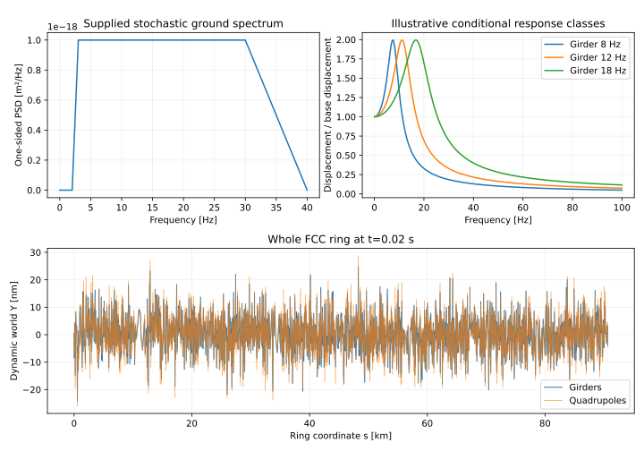

# Runnable FCC ground-motion demonstration

Run [016_fcc_ground_motion.py](016_fcc_ground_motion.py) from this checkout:

```bash
PYTHONPATH=. XSUITE_ALLOW_KERNEL_COMPILATION=1 python examples/mechanics/016_fcc_ground_motion.py
```

The default input path works in this workspace. The
[input instructions](review/FCC_INPUT.md) give the pinned external model and an
environment-variable override for another checkout. No model files are modified.

The actual 90.64 km FCC positron Z line is tracked. Mechanics moves all 2,663
quadrupoles; other lattice magnets retain their nominal placement. Each quad
has a provisional girder and a magnet child. One common seeded floor is sampled
at 10,652 contacts, fitted to rigid support motion, then processed through three
illustrative girder classes and a conditional magnet response. A selected virtual
pickup adds the quad-to-pickup response. Its location is explicitly illustrative,
not an identified FCC BPM or an online beam observer.

Edit the **User parameters** for the PSD, seed, correlation length, directional
wave, mounted pump, installation case, response classes and slow drift. Setting
`GROUND_MODEL='plane_wave'` selects a wave instead of the stochastic background;
set `PUMP_PEAK_M=0` and `DRIFT_M_PER_S=0` for a clean wave-only dynamic input.
The plane-wave branch also passed an eight-turn functional check on the FCC
line; that run is not a throughput measurement. Direction and polarization
are independent normalized world XYZ vectors. Source/response frequencies must
stay below the record Nyquist, and sampling/mode convergence remains necessary.

## What the figures show



The upper panel shows the common floor fit and the successive response outputs.
The magnet follows the support while retaining a smaller relative motion.
The lower panel compares each child with the parent transported to that same
port, so a lever arm is not mistaken for a local mechanical residual. The dashed
line marks tracking start. The negative-time portion is explicit causal
prehistory; filters start at rest at −0.4 s. Stationarity is not assumed.
The incompatible-contact residual is reported separately: about 0.532 nm RMS
in this realization. The fit keeps each support rigid.



The upper panels expose the input spectrum and supplied girder responses.
The lower panel shows the dynamic world-Y displacement of every support and
quad versus ring position, at 20 ms. The other two figures show the selected
quad's six-coordinate history and a magnified support survey. Display gains do
not affect tracking. `SAVE_GIF=True` animates the selected quad.

## Measured CPU cost

The default ran in **23.57 s**, including loading, preparation, all timing
repetitions and four captured figures. It tracks 128 turns, about 38.7 ms of
physical time. Warm complete-call medians over three repetitions were:

| One-particle case | Per 128 turns | Per turn |
| --- | ---: | ---: |
| Raw nominal line | 0.3669 s | 2.866 ms |
| Frozen installed line | 0.4149 s | 3.242 ms |
| Moving line | 0.5190 s | 4.054 ms |

Thus moving/nominal is **1.415×**, and moving/frozen is **1.251×**. Every tracked
particle survived. Source sampling/contact fitting took 2.93 s, conditional
response preparation 1.44 s and the first dynamic call 2.26 s. These costs are
separate from warm tracking. The capture retains all repetitions, including one
slow frozen-call outlier; the table uses medians.

A clean draft replay took 22.33 s. A later direct launcher check took 43.05 s,
with moving/nominal 1.669× and moving/frozen 1.685×; its individual calls varied
substantially. These observed medians still pass twofold, while wall time is
variable. All repetitions are retained rather than selecting the quickest run.

Changing `PARTICLE_COUNTS` to `(1, 32)` runs the longer throughput comparison.
That preceding run took 102 s, mainly in the repeated 32-particle tracking, and
gave **1.049× nominal** / **1.040× frozen** for 32 particles. It used whole-record
contact fitting; the shorter default uses the same fit operation in 64-sample
blocks. A small numerical check verified bitwise fit/residual parity, including
a final singleton block. These are different source snapshots and are labelled separately.
The 32 particles share one motion phase; they are not packed bunches.

The default's peak process RSS was **1.86 GiB**. The floor record occupies about
125 MiB and the resolved response records about 125 MiB combined on the host;
fitting/transport intermediates
and the lattice account for additional memory. The 1 GiB field-workspace guard
is not a total process-memory limit. Tracking retains current-pose buffers and
uploads a current source block, not a device pose history. This record is a
bounded demonstration, not the eventual long-run streaming provider.

## Physical scope

The support assignments, PSD, low-rank spatial approximation and conditional
responses are teaching inputs, not validated FCC engineering data. Contacts and
pump propagation use nominal geometry in this prescribed small-motion model;
installation does not resample the field. The 0.5 µm installation seed is
independent of the dynamic seed. The larger
uncorrected 5 µm seed lost a particle at turn 82 after nonlinear growth reached
the existing 1 m global tracking guard; 0.5 µm, 0.05 µm and zero survived this
128-turn check. The guard was retained. This does not establish an alignment
tolerance or replace closed-orbit/error correction.

The captured default uses lesson SHA-256
`18a60d8fa782698df2e6eb4179ddf8d6882895c4117d9cbf4a4e72e533173f8b`
and the native implementation at `50db418d1`. These are local macOS/ARM CPU
measurements. Actual GPU execution is pending; use the
[hardware acceptance commands](review/HARDWARE_ACCEPTANCE.md) on a real device.
Lesson [015](015_bunch_phases_and_twiss.py) separately examines bunch phases and
frozen Twiss versus driven tracking.
